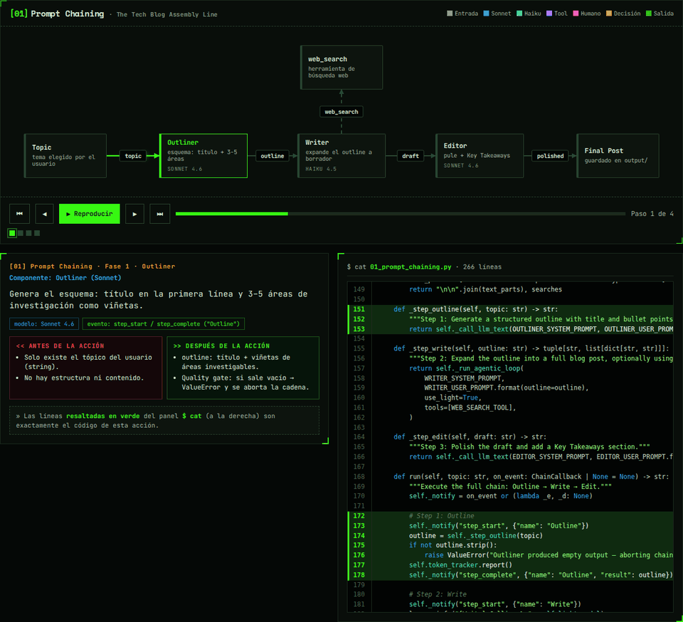
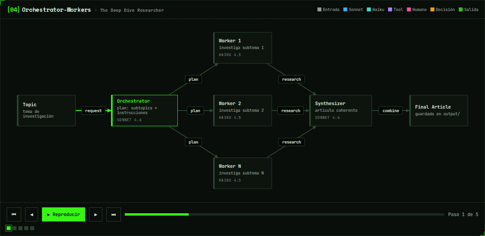
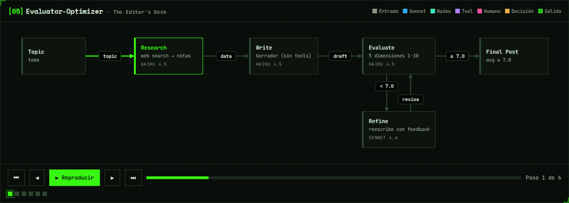
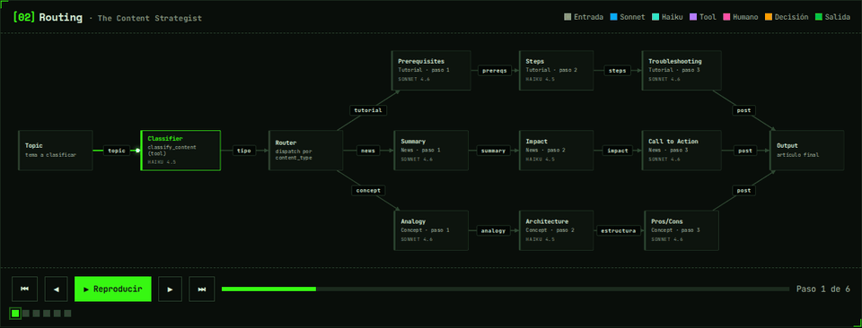
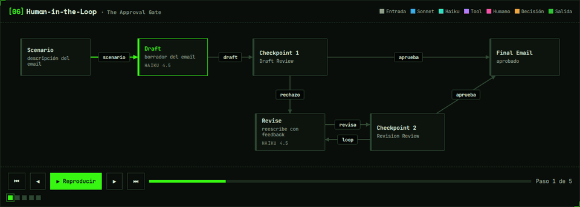

# Patrones de diseño agénticos

**Entender cómo funciona un agente de IA viéndolo ejecutarse paso a paso.**

[](LICENSE)




Los diagramas de cajas y flechas explican *qué* hace un agente, pero no *cuándo* ni *cómo*. Este
laboratorio recorre cada patrón como si fuera una ejecución real. En cada paso se ve:

- **el mapa animado**: qué componente actúa y por qué flecha viaja la información;
- **el código fuente**, con las líneas exactas de ese paso resaltadas;
- **el estado antes y después** de la acción: qué recibe el componente y qué produce;
- **el modelo, la herramienta o el evento** que interviene (`modelo: Haiku 4.5`, `tool: web_search`, …).

Es una aplicación web estática: abrís `index.html` y funciona, sin servidor, sin instalar nada y sin
conexión a internet.

## En números

| | |
|---|---|
| **12** | patrones animados, de Prompt Chaining a un agente de producción completo |
| **2.734** | líneas de Python real sincronizadas con la animación |
| **288** | técnicas de [agentic-design.ai](https://agentic-design.ai/patterns), en 5 grupos y 24 categorías |
| **41** | patrones en producción de [agentic-patterns.com](https://www.agentic-patterns.com/?status=production) |
| **329** | fichas traducidas al español |
| **320** | diagramas de flujo interactivos en la biblioteca |

## Contenido

- [Los mapas en acción](#los-mapas-en-acción)
- [Los 12 patrones](#los-12-patrones)
- [La biblioteca](#la-biblioteca)
- [Cómo usarla](#cómo-usarla)
- [Estructura del proyecto](#estructura-del-proyecto)
- [Regenerar los datos](#regenerar-los-datos)
- [Sistema de diseño](#sistema-de-diseño)
- [Accesibilidad](#accesibilidad)
- [Fuentes y atribución](#fuentes-y-atribución)

## Los mapas en acción

<table>
  <tr>
    <td width="50%">
      
      <p><b>04 · Orchestrator-Workers</b><br>Un orquestador divide la tarea en subtemas, tres workers investigan en paralelo y un sintetizador une los resultados.</p>
    </td>
    <td width="50%">
      
      <p><b>05 · Evaluator-Optimizer</b><br>Investigar, escribir, evaluar y decidir: si el borrador no alcanza la nota, se refina y vuelve a evaluarse.</p>
    </td>
  </tr>
  <tr>
    <td width="50%">
      
      <p><b>02 · Routing</b><br>Un clasificador (Haiku) etiqueta el tema como tutorial, noticia o concepto, y el router elige la cadena especializada.</p>
    </td>
    <td width="50%">
      
      <p><b>06 · Human-in-the-Loop</b><br>Dos checkpoints humanos: nada avanza hasta que una persona aprueba el borrador y la revisión.</p>
    </td>
  </tr>
</table>

Los controles se manejan con el ratón o con el teclado: `←` `→` para avanzar o retroceder, `Espacio`
para reproducir o pausar (avance automático cada 4,2 s). Un clic en cualquier nodo salta al primer paso
donde participa, y la barra de progreso permite ir a cualquier punto del recorrido.

## Los 12 patrones

Los patrones **01–07** forman una progresión: cada uno agrega una capacidad y el **Content Writer** los
combina todos. Los **08–12** son patrones fundacionales adicionales.

| # | Patrón | Idea central |
|---|---|---|
| 01 | **Prompt Chaining** | Partir una tarea en pasos encadenados: esquema → redacción → edición. |
| 02 | **Routing** | Un clasificador deriva cada pedido al especialista adecuado. |
| 03 | **Parallelization** | Lanzar subtareas en paralelo (fan-out) y sintetizar el resultado. |
| 04 | **Orchestrator-Workers** | Un orquestador planifica y reparte; los workers ejecutan; alguien consolida. |
| 05 | **Evaluator-Optimizer** | Generador y evaluador iteran hasta alcanzar la calidad pedida. |
| 06 | **Human-in-the-Loop** | Un checkpoint humano aprueba o rechaza antes de seguir. |
| 07 | **Content Writer** | Un agente de producción completo: planifica, escribe, se evalúa y publica. |
| 08 | **ReAct** | Razonar y actuar con herramientas en un bucle de observación. |
| 09 | **Map-Reduce** | Procesar documentos largos por partes y reducir los resultados. |
| 10 | **Plan-Then-Execute** | Primero un plan explícito; después, la ejecución paso a paso. |
| 11 | **Talker-Reasoner** | Dos velocidades: un modelo conversa mientras otro razona en segundo plano. |
| 12 | **Reflection** | Autocrítica con memoria: el agente revisa su salida y la corrige. |

Además del mapa y el código, cada patrón explica el concepto, qué modelo conviene en cada componente,
casos de uso reales y las técnicas relacionadas de la biblioteca.

## La biblioteca

Un catálogo de técnicas y patrones agénticos, traducido y con diagramas propios:

- **5 grupos:** Reasoning & control flow · Knowledge & memory · Tools, agents & interaction ·
  Quality & improvement · Production hardening.
- **Búsqueda** por nombre, descripción, categoría o grupo.
- Cada ficha tiene dos pestañas: **`[1] resumen`** y **`[2] visualización del flujo`**, con el mismo
  reproductor paso a paso que los patrones.
- Todos los diagramas se validan automáticamente antes de publicarse: sin nodos superpuestos, sin
  etiquetas encimadas y sin flechas que atraviesen cajas ajenas.


## Cómo usarla

No requiere instalación ni compilación. Solo hace falta un navegador moderno.

```bash
git clone https://github.com/EmanuelSotomayor/agent-design-patterns.git
cd agent-design-patterns

# opción 1: abrir el archivo directamente
xdg-open index.html          # macOS: open index.html · Windows: start index.html

# opción 2: servirla en local (útil para abrirla desde el móvil)
python3 -m http.server 8000  # y entrar a http://localhost:8000
```

## Estructura del proyecto

```
.
├── index.html                  # la aplicación completa (HTML + CSS + JS)
├── library_data.js             # biblioteca generada: 329 fichas y sus diagramas
├── src/
│   ├── 01_*.py                 # código de los patrones 01–06
│   ├── content_writer_agent.py # agente completo (patrón 07)
│   ├── ref/                    # implementaciones de referencia 08–12
│   └── library/                # fuentes de la biblioteca
│       ├── techniques_en.json  # 288 técnicas (original en inglés)
│       ├── production_en/      # 41 patrones en producción (original en inglés)
│       ├── es/                 # 329 traducciones al español
│       └── taxonomy_es.json    # grupos, categorías y descripciones
├── tools/                      # motor de diagramas y validadores
├── build.py                    # inyecta el código fuente en index.html
├── generate_library.py         # genera library_data.js
├── fonts/                      # Space Mono y JetBrains Mono (auto-hospedadas)
├── DESIGN.md                   # sistema de diseño en formato DESIGN.md
├── .claude/skills/terminal-mono-ui/  # skill reutilizable del sistema de diseño
└── docs/                       # capturas y GIFs de este README
```

## Regenerar los datos

La aplicación es estática, pero la biblioteca y el código embebido se generan con dos scripts
(Python 3.9+, solo biblioteca estándar):

```bash
python3 generate_library.py   # 1) construye library_data.js desde src/library/
python3 build.py              # 2) inyecta src/*.py en index.html (idempotente)
```

`generate_library.py` usa `tools/diagrams.py` para calcular la geometría de cada diagrama (posiciones,
rutas de flechas y ubicación de etiquetas) y la valida antes de escribir. `build.py` inserta cada
archivo fuente y define qué líneas se resaltan en cada paso.

## Sistema de diseño

La interfaz tiene una estética de **terminal**: tipografía monoespaciada, fondo casi negro y un único
color de acento, el verde `#37F712`, que siempre significa *estado* (activo, foco, selección). No usa
sombras, degradados, esquinas redondeadas ni emojis; la jerarquía se construye con bordes, tonos de
superficie y marcadores de texto como `[01]`, `// sección`, `<< antes` / `>> después` o
`$ cat archivo.py`.

El sistema está documentado para reutilizarlo en otros proyectos:

- **[`DESIGN.md`](DESIGN.md)**: tokens de color, tipografía, espacio, forma y movimiento, más
  componentes, navegación, voz y guía de diagramas. Sigue el formato [DESIGN.md](https://designmd.app/) y
  se valida con `npx -y @google/design.md lint DESIGN.md`.
- **[`.claude/skills/terminal-mono-ui/`](.claude/skills/terminal-mono-ui/SKILL.md)**: skill para agentes
  de código con `theme.css` listo para copiar, hoja de componentes, plantilla de `DESIGN.md`, fuentes y
  scripts para inventariar y verificar el layout. Para instalarla en todos tus proyectos:
  `cp -r .claude/skills/terminal-mono-ui ~/.claude/skills/`.

## Accesibilidad

- Todo el texto informativo supera el contraste **4,5:1** de WCAG AA; la mayoría, 7:1 o más.
- Navegación completa con teclado (`Tab`, `Enter`, flechas y `Espacio`) y foco siempre visible.
- Botones de al menos 44 px de alto.
- Con `prefers-reduced-motion` activo se eliminan parpadeos y transiciones.
- Funciona sin ratón y sin conexión.

## Fuentes y atribución

- Patrones **01–07**: código de
  [agenticloops-ai/agentic-ai-engineering](https://github.com/agenticloops-ai/agentic-ai-engineering/tree/main/02-effective-agents) (MIT).
- Patrones **08–12**: implementaciones de referencia ilustrativas.
- Técnicas, resúmenes y flujos: [agentic-design.ai](https://agentic-design.ai/patterns).
- Patrones en producción: [agentic-patterns.com](https://www.agentic-patterns.com/?status=production).
- Tipografías: [Space Mono](https://fonts.google.com/specimen/Space+Mono) y
  [JetBrains Mono](https://www.jetbrains.com/lp/mono/), bajo SIL Open Font License 1.1 (licencias
  incluidas en la skill).

Las traducciones, los diagramas animados y la presentación son trabajo propio sobre esas fuentes. Los
nombres de patrones, técnicas y productos se mantienen en su idioma original.

## Licencia

[GNU General Public License v3.0](LICENSE).

## Autor

Hecho por **Hex4w0rd** · [Emanuel Sotomayor](https://github.com/EmanuelSotomayor).
