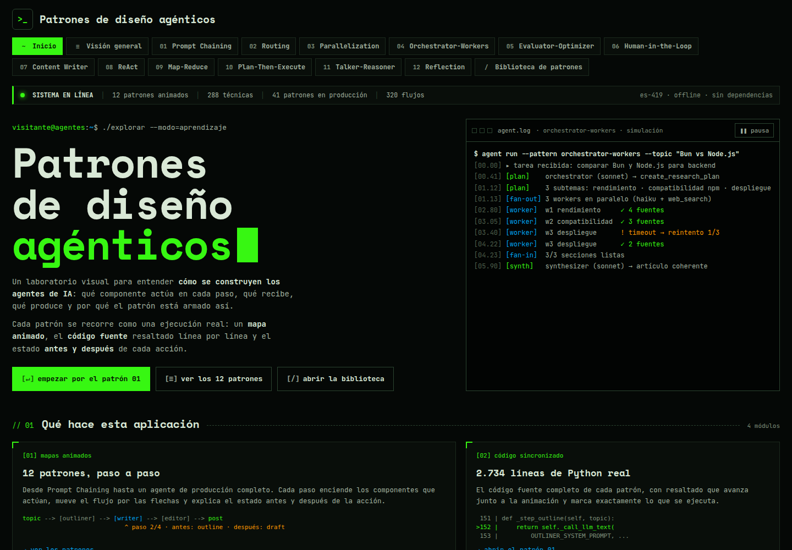

# Patrones de diseño agénticos

**Un laboratorio visual, offline y sin dependencias, para entender cómo se construyen los agentes de IA.**



Cada patrón se recorre como una ejecución real: un **mapa animado** que enciende los componentes que
actúan en cada paso, el **código fuente** resaltado línea por línea y el **estado antes y después** de
cada acción. La idea es responder, para cada técnica, qué componente trabaja, qué recibe, qué produce y
por qué el patrón está armado así.

- **12 patrones animados**, de Prompt Chaining a un agente de producción completo.
- **288 técnicas** de [agentic-design.ai](https://agentic-design.ai/patterns) en **5 grupos** y **24 categorías**.
- **41 patrones en producción** de [agentic-patterns.com](https://www.agentic-patterns.com/?status=production).
- **329 fichas en español**, **320 con diagrama de flujo** paso a paso.
- **2.734 líneas de Python real** sincronizadas con la animación.
- **100 % del lado del cliente**: se abre el archivo y funciona. Sin servidor, sin build, sin CDN, sin
  telemetría. Las tipografías están auto-hospedadas y la aplicación funciona sin conexión.

## Qué incluye

### Los 12 patrones

| # | Patrón | Qué muestra |
|---|---|---|
| 01 | **Prompt Chaining** | Una tarea se parte en pasos encadenados: esquema → redacción → edición. |
| 02 | **Routing** | Un clasificador deriva cada consulta al especialista adecuado. |
| 03 | **Parallelization** | Fan-out de subtareas en paralelo y síntesis del resultado. |
| 04 | **Orchestrator-Workers** | Un orquestador reparte el trabajo, los workers investigan y él consolida. |
| 05 | **Evaluator-Optimizer** | Un generador y un evaluador iteran hasta alcanzar la calidad pedida. |
| 06 | **Human-in-the-Loop** | Un checkpoint humano aprueba o rechaza antes de ejecutar la acción. |
| 07 | **Content Writer** | El agente completo de producción: planifica, escribe, se autoevalúa y publica. |
| 08 | **ReAct** | Razonar y actuar con herramientas en un bucle de observación. |
| 09 | **Map-Reduce** | Documentos largos: se procesan por partes y se reduce el resultado. |
| 10 | **Plan-Then-Execute** | Primero un plan explícito; después, la ejecución paso a paso. |
| 11 | **Talker-Reasoner** | Dos velocidades: un modelo conversacional y otro que razona en segundo plano. |
| 12 | **Reflection** | Autocrítica con memoria: el agente revisa su salida y corrige. |

Cada patrón incluye el diagrama animado, la tarjeta del paso actual, el código fuente completo con las
líneas del paso resaltadas, el concepto, los modelos sugeridos, los casos de uso y las técnicas
relacionadas de la biblioteca.

### La biblioteca

- **Grupos:** Reasoning & control flow · Knowledge & memory · Tools, agents & interaction ·
  Quality & improvement · Production hardening.
- **Búsqueda** por nombre, resumen, categoría o patrón.
- Cada ficha tiene **dos pestañas**: `[1] resumen` y `[2] visualización del flujo`.
- Los diagramas se normalizan y validan antes de renderizar: sin nodos superpuestos, sin etiquetas
  encimadas y sin flechas que atraviesen cajas ajenas.

### El reproductor de pasos

- Reproducción automática cada 4,2 s, o manual con `←` `→` y `Espacio`.
- Al avanzar se iluminan los nodos y las flechas que participan; un punto recorre el flujo activo.
- El visor de código hace scroll hasta las líneas del paso.
- Un clic en cualquier nodo salta al primer paso donde participa.
- La barra de progreso es clicable y los puntos indican hecho / actual / pendiente.

## Cómo ejecutarla

No hace falta instalar nada ni compilar:

```bash
# opción 1: abrir el archivo directamente
xdg-open index.html

# opción 2: servirla en local (recomendado para probar en el móvil)
python3 -m http.server 8000
# luego abrir http://localhost:8000
```

Requisitos: un navegador moderno. Para regenerar los datos, Python 3.9+ (solo biblioteca estándar).

## Estructura del proyecto

```
.
├── index.html                  # la aplicación completa (HTML + CSS + JS)
├── library_data.js             # biblioteca generada: 329 fichas y sus diagramas
├── src/
│   ├── 01_*.py                 # código de los patrones 01–07
│   ├── content_writer_agent.py # agente completo (patrón 07)
│   ├── ref/                    # implementaciones de referencia 08–12
│   └── library/                # fuentes de la biblioteca
│       ├── techniques_en.json  # 288 técnicas (original en inglés)
│       ├── production_en/      # 41 patrones en producción (original en inglés)
│       ├── es/                 # 329 traducciones al español
│       └── taxonomy_es.json    # grupos, categorías y descripciones
├── tools/                      # generadores y validadores de diagramas
├── fonts/                      # Space Mono y JetBrains Mono (auto-hospedadas)
├── DESIGN.md                   # sistema de diseño en formato DESIGN.md
├── .claude/skills/terminal-mono-ui/  # skill reutilizable del sistema de diseño
└── docs/home.png               # captura usada en este README
```

## Cómo se genera

La aplicación es estática, pero la biblioteca y el código embebido se generan con scripts:

```bash
# 1) construye library_data.js a partir de src/library/ y tools/diagrams.py
python3 generate_library.py

# 2) inyecta el código fuente de src/*.py en index.html (idempotente)
python3 build.py
```

`generate_library.py` normaliza los diagramas (coordenadas, rutas de flechas, etiquetas) y valida que no
haya colisiones. `build.py` inserta cada archivo como bloque `text/plain` y calcula los rangos de líneas
resaltados por paso.

## Sistema de diseño

La interfaz sigue una estética **terminal / hacker** documentada y reutilizable:

- **`DESIGN.md`** — tokens (color, tipografía, espacio, forma, movimiento), principios, componentes,
  navegación, voz y guía de diagramas de agentes. Formato [DESIGN.md](https://designmd.app/), validable
  con `npx -y @google/design.md lint DESIGN.md`.
- **`.claude/skills/terminal-mono-ui/`** — skill con `theme.css` listo para copiar, hoja de componentes,
  plantilla de `DESIGN.md`, fuentes y scripts de inventario y verificación de layout.

Reglas centrales: monoespaciado como estructura, un único acento verde (`#37F712`) que siempre significa
**estado**, jerarquía por bordes y tonos de superficie (sin sombras ni degradados), radio 0, marcadores
de texto en lugar de emojis (`[01]`, `// sección`, `<< antes` / `>> después`, `$ cat archivo.py`) y
movimiento solo cuando explica un proceso.

## Accesibilidad

- Todo el texto informativo supera **4,5:1** de contraste WCAG AA (la mayoría, 7:1 o más).
- Foco visible en todos los elementos interactivos; paneles enlazables operables con teclado.
- Botones de al menos 44 px de alto; navegación completa con `Tab`, `Enter`, flechas y `Espacio`.
- `prefers-reduced-motion`: sin parpadeo ni transiciones, y los logs aparecen completos.
- La aplicación no requiere ratón ni conexión a internet.

## Fuentes y atribución

- Patrones **01–07**: código de
  [agenticloops-ai/agentic-ai-engineering](https://github.com/agenticloops-ai/agentic-ai-engineering/tree/main/02-effective-agents).
- Patrones **08–12**: implementaciones de referencia ilustrativas.
- Técnicas, resúmenes y flujos: [agentic-design.ai](https://agentic-design.ai/patterns).
- Patrones en producción: [agentic-patterns.com](https://www.agentic-patterns.com/?status=production).
- Tipografías: [Space Mono](https://fonts.google.com/specimen/Space+Mono) y
  [JetBrains Mono](https://www.jetbrains.com/lp/mono/), bajo SIL Open Font License 1.1 (las licencias
  están incluidas en `fonts/` y en la skill).

Las traducciones al español y la presentación son trabajo propio sobre esas fuentes; los nombres propios
de patrones, técnicas y productos se mantienen en su idioma original.

## Licencia

[GNU General Public License v3.0](LICENSE).

## Autor

Hecho por **Hex4w0rd** ([Emanuel Sotomayor](https://github.com/EmanuelSotomayor)).
